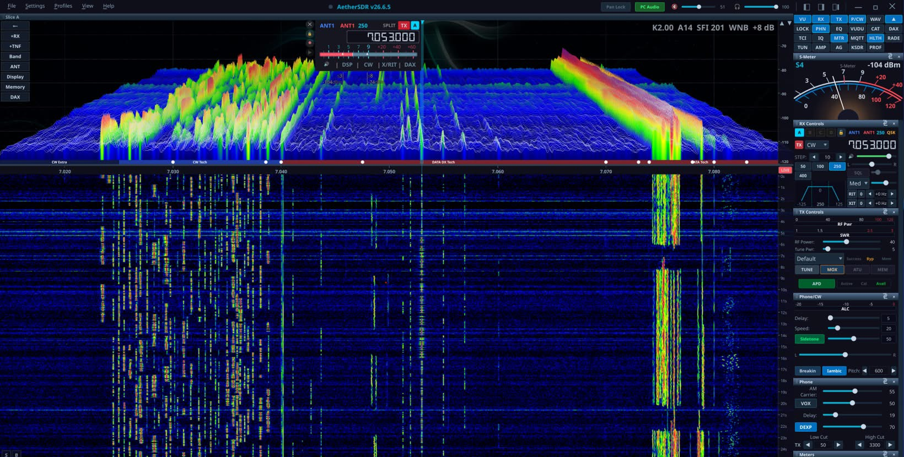

# AetherSDR — ANAN fork (Ater-ugly_fork)

> **This is an unofficial fork of [AetherSDR](https://github.com/aethersdr/AetherSDR) v26.10.4**
> for the **Apache Labs ANAN** transceivers over **openHPSDR Protocol 2**. It was developed on
> an ANAN-100D (Odyssey FPGA firmware). It is not affiliated with or supported by the AetherSDR
> project. Please report problems with this fork here, not upstream.

**What the fork adds**

- openHPSDR Protocol 2 backend for the ANAN radios: RX1/RX2, TX, drive, attenuators, LNA, Alex filters
- PureSignal (WDSP calcc) with feedback attenuator auto-ranging, drive feed-forward,
  manual per-band TX delay measurement with thermal drift compensation, Thetis-style scheck
- HW Diag, RGMII tune, PS amplifier view and wideband monitor dialogs
- S-meter calibration (correction, ATT and LNA compensation)
- Thetis-style Auto AGC: AGC threshold follows the noise floor plus an adjustable offset (NF+)
- Per-model settings page (Setup → Radio → *your model*): model selection, microphone and
  connector options, PA level and power meter calibration

## Supported transceivers

All radios that Thetis drives over Protocol 2. The radio reports its board, not its model, so
for boards shared by several models pick yours in **Setup → Radio → (model page) → Model**.

| Board (Discovery id) | Models | Receivers | ADCs | Filters | PureSignal | Mic / connector options | Status bar | Tested |
|---|---|---|---|---|---|---|---|---|
| Hermes (1) | ANAN-10, ANAN-100 | from DDC0 | 1 | Alex HPF + LPF | — | — | supply V | no |
| Hermes II (2) | ANAN-10E, ANAN-100B | from DDC0 | 1 | Alex HPF + LPF | — | — | supply V | no |
| Angelia (3) | ANAN-100D | from DDC2 | 2 | Alex HPF + LPF | yes | — | supply V | **yes** |
| Orion (4) | ANAN-200D | from DDC2 | 2 | Alex HPF + LPF | yes | mic PTT, tip/ring, bias | supply V | no |
| Orion II (5) | ANAN-7000DLE, ANAN-8000DLE, Orion MkII, Anvelina Pro3 | from DDC2 | 2 | band-pass RX1 + RX2 | yes | mic PTT, tip/ring, bias, RX2 ground on TX | PA V, PA current* | no |
| Saturn (10, 11) | ANAN-G2, ANAN-G2-1K | from DDC2 | 2 | band-pass RX1 + RX2 | yes | mic PTT, tip/ring, bias, XLR input, RX2 ground on TX | PA V, PA current | no |
| HermesC10 (20) | ANAN-G2E | from DDC0 | 1 | band-pass | — | — | PA V, PA current | no |

\* Orion MkII: supply voltage only, as in Thetis.

- The number of receivers (slices) comes from the radio's own DDC count, up to 4.
- PureSignal is not available on the single-ADC boards: their receivers use DDC0/DDC1, which
  PureSignal needs for the feedback and the TX reference.
- No ANAN reports a PA temperature over Protocol 2. The status bar shows the voltage and, while
  transmitting, the PA drain current ("Id") instead.
- Power meter, voltage, current and S-meter constants follow Thetis for each model. The PA level
  and power meter calibration on the model page let you match your radio.

## Build 170

- Support for every Protocol 2 ANAN in the table above. Before this build only the ANAN-100D and
  200D were found on the network, so ANAN-G2 and 7000DLE users could not connect.
- ANAN-7000DLE / 8000DLE / G2 / G2-1K / G2E filter scheme (band-pass filters for both ADCs, TX
  low-pass filter on transmit only, RX2 input grounded on TX).
- Setup → Radio: the hardware page is named after the radio and has **Model** and
  **Microphone & Connectors** groups. Mic PTT, PTT on tip / mic on ring, mic bias, and the G2
  balanced XLR input are available.
- PA voltage and PA drain current in the status bar on the 7000DLE, 8000DLE, G2 and G2E.
- Reflected power uses Thetis' own reflected-power constants for each model, so SWR readings
  change slightly, mostly on 6 m.
- Fixed: the attenuator's AUTO button in the panadapter's antenna panel did not stay on (the
  automatic attenuator never ran).
- Auto AGC: with Auto on, the AGC-T slider shows where the automatic AGC has set the gain; its
  tooltip shows the measured noise floor and the NF+ offset.
- Only the ANAN-100D has been tested on the air. If you have one of the other radios, please try
  receive first, then transmit at low power, and report what you see (see below).

## Windows portable build

Download the ZIP from the [Releases](https://github.com/Dfinitski/Ater-ugly_fork/releases) page,
unpack it to any folder and run `AetherSDR.exe`. No installer is needed. If the program does not
start, install the Microsoft Visual C++ 2015–2022 x64 runtime (`vc_redist.x64.exe`, included in
the ZIP).

The fork version is identified by its build number (`AETHER_FORK_BUILD` in
`src/core/ForkBuild.h`, also shown in Help → About); releases are tagged `build-NNN`.

## Reporting a problem

Open an [issue](https://github.com/Dfinitski/Ater-ugly_fork/issues) and attach the log of the
session where the problem happened.

1. Reproduce the problem, then close AetherSDR (the log is complete once the program exits).
2. Open the log folder:
   - from the program: **Help → Support & Diagnostics… → Open Log Folder**, or
   - in Explorer: `%LOCALAPPDATA%\AetherSDR\logs`
     (usually `C:\Users\<you>\AppData\Local\AetherSDR\logs`).
3. Attach the newest file, `aethersdr-YYYYMMDD-HHMMSS.log`. A new file is started each time the
   program runs, named by date and time.

In the issue, please say:
- the radio model and the model selected on the Setup → Radio page;
- the build number;
- what you did and what went wrong.

License: GPL v3, same as upstream (see `LICENSE`). Features inherited from AetherSDR v26.10.4 are
listed below.

---

## Features inherited from AetherSDR

- **GPU-accelerated spectrum & waterfall** — QRhi rendering (OpenGL/Metal/D3D11) with a per-pixel FFT trace at up to **60 fps**, optional FFT Smooth and De-comb trace shaping, an optional **3D stacked-trace** mode, ~71% less CPU than the paint path, GPU-composited slice flags and multi-GPU adapter selection
- **AetherTX and AetherRX** — the transmit and receive chains, one window each. AetherTX is the channel strip (gate, EQ, compressor, de-esser, tube, AetherVoice exciter, reverb, brickwall limiter) with a preset library and scope; AetherRX puts noise reduction, gate, EQ, compressor, tube, AetherVoice and the output meter on tabs down its left edge
- **Seven client-side noise-reduction engines**, each denoising left and right independently so pans and diversity survive them — NR2 (spectral), RN2 (RNNoise), NR4 (libspecbleach), NNR (WDSP's Neural Noise Reduction), DFNR (DeepFilterNet3), BNR (the NVIDIA Maxine denoiser, in-process on a local RTX/GeForce GPU, Linux + Windows — `docs/nvidia-bnr.md`) and MNR (macOS)
- **AetherModem packet radio** — KISS-over-TCP TNC, connected-mode AX.25 BBS, a personal mailbox, a WIDE1-1 fill-in digipeater, and an **APRS client** (station table, GPS beacon, messaging) on a Direwolf-derived VHF demodulator
- **SpotHub** — DX Cluster, RBN, WSJT-X, POTA, FreeDV Reporter, N1MM+/DXLog contest bandmap, the EiBi shortwave schedule and the KiwiSDR DX Community database, with auto-mode switch and per-feed colouring
- **Local voice keyer** — twelve PC-microphone recordings up to 30 seconds each, with preview, import/export and F1–F12 playback
- **CW operator suite** — ggmorse plus download-on-demand DeepCW and DeepFist receive decoders where ONNX Runtime is available (ggmorse only on Intel macOS), MIDI/keyboard straight-key and iambic paddles with full QSK, optional Quindar tones
- **Copy Assist (speech-to-text)** — on-device transcription of received voice via whisper.cpp, docked under the waterfall with confidence colour-coding, optionally from the audio before noise reduction. CPU or GPU (Vulkan/Metal, auto-detected), download-on-demand models, optional remote OpenAI-compatible endpoint. Not in the Intel macOS build — see `docs/asr-copy-assist.md`
- **FreeDV RADE** — AI digital-voice codec with a client-side neural encoder/decoder
- **AetherMap (PSK Reporter) overlays** — optional global precipitation (LibreWXR, with NOAA, ECCC and EUMETNET OPERA regional radar backups and a per-provider legend), NOAA/NWS weather radar with observation playback (`docs`) and a NASA/GSFC VIIRS night-lights layer that fades through civil twilight (`docs`), on both the 2D map and 3D globe
- **Workspace canvas** — place pans and applets freely as resizable, layered items with edge and grid snapping, across several windows if you want them. Named workspaces recall which applets are open as well as where they sit, and bind to radio profiles. Off by default; the Classic shell is unchanged until you enable it
